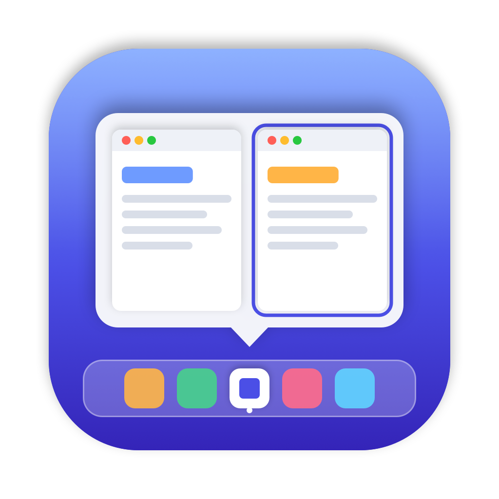

<p align="center">
  
</p>

<h1 align="center">DockPeek</h1>

<p align="center">Všechna okna na dosah přímo z Docku.</p>

DockPeek přináší na macOS funkci známou z Windows: po najetí myší na běžící aplikaci
v Docku se nad ikonou zobrazí náhledy všech jejích oken. Kliknutím na náhled se okno
přenese dopředu.

## Funkce

- **Náhledy oken** po najetí na ikonu v Docku, včetně minimalizovaných oken.
- **Přepnutí na okno** kliknutím na náhled; minimalizované okno se obnoví.
- **Zavření okna** křížkem, který se objeví po najetí na náhled.
- **Ovládání přehrávačů:** u Spotify a Hudby lišta s obalem alba, skladbou,
  tlačítky předchozí / přehrát-pozastavit / další a posuvníkem průběhu skladby.
  Funguje i ve chvíli, kdy má přehrávač zavřené okno.
- **Vzhled náhledů:** podle systému, podle aplikace (tmavá aplikace = tmavý panel),
  světlý nebo tmavý.
- **Dock dole, vlevo i vpravo.**
- Panel uhne kontextové nabídce Docku (pravé tlačítko, Ctrl+klik, podržení).
- Průvodce nastavením při prvním spuštění, okno O aplikaci, ikona ve stavovém řádku.

## Požadavky

- macOS 14 Sonoma nebo novější (vyvíjeno a testováno na macOS 26).
- Pro sestavení Xcode 16+ (Swift 5.10+) a volitelně certifikát Apple Development.

## Instalace z DMG (pro uživatele)

1. Stáhněte `DockPeek-<verze>.dmg` ze stránky
   [Releases](https://github.com/kolarcik/DockPeek/releases).
2. Otevřete DMG a přetáhněte **DockPeek** do složky **Aplikace**.
3. Spusťte DockPeek ze složky Aplikace a projděte průvodce nastavením
   (viz [První spuštění a oprávnění](#3-první-spuštění-a-oprávnění)).

Oficiální DMG je podepsané certifikátem Developer ID a notarizované u Apple,
takže se otevře bez varování.

> DMG sestavené bez Developer ID (viz níže) macOS při prvním otevření zablokuje.
> Pak v **Nastavení systému → Soukromí a zabezpečení** u zprávy o DockPeek
> klikněte na **Přesto otevřít**.

DMG obsahuje univerzální aplikaci pro Macy s Apple Silicon i Intel.

## Sestavení ze zdrojových kódů

### 1. Sestavení

```bash
git clone https://github.com/kolarcik/DockPeek.git
cd DockPeek
./build.sh
```

Výsledná aplikace je v `build/DockPeek.app`.

`build.sh` aplikaci podepíše certifikátem **Apple Development** týmu `3ZN9TSG9S7`
(výběr je v `signing.sh`). Jiný tým nastavíte proměnnou `TEAM_ID`, konkrétní
certifikát proměnnou `CODESIGN_IDENTITY`:

```bash
CODESIGN_IDENTITY="Apple Development: Jméno Příjmení (TEAMID)" ./build.sh
```

Bez certifikátu se aplikace podepíše ad-hoc (`-`). Funguje, ale macOS pak po každém
novém sestavení zapomene udělená oprávnění a bude je chtít znovu.

### 2. Přesun do složky Aplikace (doporučeno)

```bash
cp -R build/DockPeek.app /Applications/
open /Applications/DockPeek.app
```

Ze složky Aplikace spolehlivě funguje i volba „Spouštět DockPeek po přihlášení“.

### 3. První spuštění a oprávnění

Při prvním spuštění se otevře **průvodce nastavením**. Stačí v něm projít řádky
a kliknout na **Povolit**:

| Oprávnění | K čemu je potřeba | Povinné |
|---|---|---|
| **Zpřístupnění** | Pozná, nad kterou ikonou v Docku je myš, a přepíná okna. | ano |
| **Nahrávání obrazovky** | Vytváří náhledy oken. Po povolení je potřeba DockPeek restartovat (průvodce nabídne tlačítko). | ano |
| **Automatizace – Spotify / Hudba** | Ovládání přehrávání z náhledu. | ne |

Průvodce se znovu otevře při každém spuštění, dokud povinná oprávnění chybí.
Kdykoli ho otevřete i z ikony ve stavovém řádku → **Průvodce nastavením…**

## Ovládání

- **Najeďte myší** na běžící aplikaci v Docku – po 0,2 s se ukáže panel s náhledy.
- **Klik na náhled** přepne na okno. **✕** v rohu náhledu okno zavře.
- U Spotify a Hudby **lišta přehrávače**: tlačítka a posuvník (klik nebo tažení posune skladbu).
- Panel zmizí, když myš opustí ikonu i panel.
- **Ikona ve stavovém řádku** (karta se dvěma okénky nad lištou Docku) obsahuje:
  - O aplikaci DockPeek
  - stav oprávnění (kliknutím otevřete příslušné Nastavení)
  - Průvodce nastavením…
  - Vzhled náhledů – Podle systému / Podle aplikace / Světlý / Tmavý
  - Ukončit DockPeek

## Řešení potíží

**Náhledy ukazují jen ikonu aplikace místo obsahu okna**
Chybí oprávnění Nahrávání obrazovky, nebo ho macOS ještě nenačetl. Povolte ho
a DockPeek restartujte. Pokud to nepomůže, smažte uložený stav a povolte znovu:

```bash
tccutil reset ScreenCapture cz.kolarcik.DockPeek
```

**Panel se po najetí na Dock vůbec neukáže**
Zkontrolujte v menu DockPeek řádek „Dock: sleduji ✓“ a oprávnění Zpřístupnění.
Případně obdobně resetujte:

```bash
tccutil reset Accessibility cz.kolarcik.DockPeek
```

**Ovládání Spotify nefunguje**
Povolte DockPeek v Nastavení systému → Soukromí a zabezpečení → Automatizace → Spotify.

**Po instalaci nové verze chce DockPeek oprávnění znovu**
macOS váže oprávnění na podpis aplikace. Verze podepsaná jiným certifikátem
(např. vlastní build vs. DMG) je pro systém jiná aplikace – povolte ji znovu,
případně nejdřív resetujte staré záznamy příkazy `tccutil reset` výše.

**Diagnostika**
Spuštění s logováním zapisuje do `/tmp/dockpeek.log`, co se děje při najetí na ikony:

```bash
open build/DockPeek.app --args --log
```

Výpis položek Docku, oken a stavu snímků do `/tmp/dockpeek-dump.txt`:

```bash
open -n -W build/DockPeek.app --args --dump
```

## Známá omezení

- Okna na jiných plochách (Spaces) se nezobrazují – Accessibility API je nevrací.
- Ovládání médií jen pro Spotify a Hudbu (přes AppleScript). Systémové „Now Playing“
  je od macOS 15.4 pro aplikace třetích stran nedostupné.
- Při prvním najetí na aplikaci v režimu „Podle aplikace“ se panel na zlomek sekundy
  ukáže v barvě systému, než jsou hotové snímky oken.
- Systémový popisek s názvem aplikace nad ikonou nejde skrýt; panel ho zakrývá.

## Vývoj

Projekt je Swift Package (bez Xcode projektu), AppKit + kousky SwiftUI.

```
Sources/DockPeek/
├── main.swift           – start aplikace, ikona ve stavovém řádku, menu, diagnostika
├── DockObserver.swift   – sledování najetí myši na položky Docku (Accessibility)
├── AX.swift             – pomocné funkce pro Accessibility API, převod souřadnic, log
├── Windows.swift        – seznam oken, přepnutí/zavření okna, snímky (ScreenCaptureKit)
├── PreviewPanel.swift   – panel s náhledy, témata, umístění a skrývání panelu
├── HoverView.swift      – společný základ pro prvky reagující na myš
├── Media.swift          – ovládání přehrávačů (AppleScript), lišta přehrávače, posuvník
├── Onboarding.swift     – průvodce nastavením (SwiftUI)
├── About.swift          – okno O aplikaci a právní dokumenty (SwiftUI)
└── StatusIcon.swift     – ikona do stavového řádku
Resources/               – Info.plist, ikona aplikace, logo autora
Tools/make-icon.swift    – generátor ikony aplikace
build.sh                 – sestavení a podepsání DockPeek.app (vývoj)
make-dmg.sh              – instalační DMG pro distribuci
```

### Vytvoření instalačního DMG

```bash
./make-dmg.sh
```

Vytvoří `build/DockPeek-<verze>.dmg` (verze se bere z `Resources/Info.plist`):
univerzální binárka, podpis s hardened runtime a entitlementem pro AppleScript
(`Resources/DockPeek.entitlements`), DMG se zástupcem složky Aplikace a ikonou svazku.

Aby šla aplikace stažená z internetu otevřít bez varování, musí být podepsaná
certifikátem **Developer ID Application** a notarizovaná u Apple:

1. V [Apple Developer → Certificates](https://developer.apple.com/account/resources/certificates/list)
   vytvořte certifikát **Developer ID Application** (může jen Account Holder týmu)
   a nainstalujte ho do Klíčenky.
2. Jednou uložte přihlašovací údaje pro notarizaci do Klíčenky
   (heslo pro aplikace z [account.apple.com](https://account.apple.com)):
   ```bash
   xcrun notarytool store-credentials dockpeek --apple-id <apple-id> --team-id <TEAMID>
   ```
3. Sestavte DMG s notarizací:
   ```bash
   NOTARY_PROFILE=dockpeek ./make-dmg.sh
   ```

Skript certifikát Developer ID najde sám; bez něj podepíše DMG certifikátem
Apple Development a upozorní, že DMG není notarizované.

### Užitečné příkazy

```bash
swift build                       # rychlá kontrola kompilace
./build.sh && open build/DockPeek.app --args --log
open build/DockPeek.app --args --onboarding   # vynutí průvodce
open build/DockPeek.app --args --about        # otevře O aplikaci
swift Tools/make-icon.swift       # přegeneruje Resources/AppIcon.icns a AppIcon.png
```

## Soukromí

Snímky oken vznikají jen v paměti Macu a nikam se neukládají ani neodesílají.
DockPeek nemá server, reklamy ani analytiku. Podrobnosti jsou v aplikaci
v okně O aplikaci → Zásady ochrany soukromí.

---

© 2026 Luděk Kolarčík · KOLARCIK – Simple solutions for complex days
